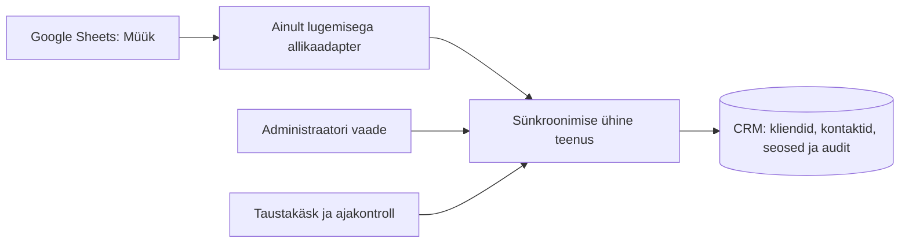

# Google Sheetsi kliendiandmete sünkroonimine

## Piirid ja andmete vastutus

See moodul on ühe suunaga Google Sheets → CRM integratsioon. See ei ole vestluse Google'i ühendus ega brauseri taimer. Veebiliides ja eraldi taustakäsk kasutavad sama koordinaatorteenust.

- `server/integrations/google-sheets/source.js`: teenusekonto autentimine ja ainult vajalike veergude lugemine Google API-st; ei kirjuta CRM-i ega tabelisse.
- `model.js`: päiste, püsivate ID-de ja kontaktandmete valideerimine ning Europe/Tallinn ajakava.
- `service.js`: üks ühine seostamise, uuendamise, konfliktide ja auditikirjete loogika; andmebaasitehingud ja protsessidevaheline lukk.
- `server/routes/google-sheets.js`: ainult administraatori töörežiimi API.
- `private/google-sheets.html` ja `public/google-sheets-admin.js`: eraldi administraatori vaade, mitte lisatud äriloogika prototüübi HTML-i.
- `ops/sync-google-sheets.js`: eraldi ajastatav töötaja. See ei impordi veebirakendust ega e-posti töötlejaid.



| Tabeli andmed | Reegel |
| --- | --- |
| `CRM ID` | Allikarea muutumatu UUID; ei ole CRM-i sisemine numbriline kliendi ID |
| `firma nimi` | Kliendi nimi; olemasoleva CRM-kliendi puhul konfliktireegliga |
| `inimese nimi`, `meiliaadress`, `telefon` | Seotud kontaktisiku andmed; konfliktireegliga |
| `allikas`, `Potensiaal 1-5`, `Huvi tase 1-5`, `Tõenäeosus %` | Säilitatakse integratsiooni metaandmetena, nähtavad ülevaatust vajava rea juures; need ei muuda müüginumbreid ega tegevusi |
| `staatus` | CRM-i staatust üle ei kirjutata. Täiesti uue ja mittetühja tabelistaatusega rea automaatne aktiveerimine blokeeritakse ning vajab administraatori otsust |
| Faasiandmed (välja arvatud allkirjeldatud vastutajatähis), kuupäevad, kirjad, vastused, kommentaarid, followup'ide arv | Ei impordita CRM-i töövoo või ajaloo asemele |

Vastutaja veerg võib olla üheselt nimetatud **Vastutaja**. Praeguse lähtefaili puhul tuntakse ära ka olemasolev täpne paigutus: B-veeru päis on Faas ja C-veeru päis Faas; vastutajamärgid asuvad C-veerus. Kui päised seda lepingut enam ei kinnita, ei arvata veergu väärtuste järgi. Väljaspool seda pärandpaigutust tuleb kasutada üheselt nimetatud Vastutaja veergu.

Server küsib päised ning seejärel ainult lubatud veerud. Firma, kontakti, e-posti, telefoni, CRM ID ja staatuse päised peavad olema ühesed; tegevusfaasi veerg jääb kõrvale, pärandpaigutuse C-veergu loetakse ainult vastutaja tähisena. Lugemise järel kontrollitakse, et päised pole vahepeal muutunud. Vanade kirjade ja tegevuste sisu ei loeta Google'ist impordi tarbeks.

## Seostamine ja konfliktid

Iga Google'i rida seotakse püsiva UUID kaudu ühe CRM-kliendi ja vajadusel ühe kontaktiga. Mitu rida võivad administraatori kinnitusega kuuluda samale kliendile. Nimi ja e-post on ainult võimaliku duplikaadi leidmise vihjed, mitte automaatse seostamise võti.

Esimene mittetühi tabeliseis läheb tervikuna administraatori ülevaatusele ka siis, kui nime või e-posti vastet ei leita: nii ei dubleerita enne ID-de loomist muudetud nime ja e-postiga vanu kliente. Edaspidi täiesti uus, kehtiva ID ja tühja tabelistaatusega rida lisatakse `Lead` tüüpi kliendina ainult siis, kui võimalikke olemasolevaid vasteid ei leita. Vastutaja valitakse tabeli tähise järgi: **P → Palme, I → Indrek, E või tühi → Eero**. Kasutaja ID-d tulevad serveri selgesõnalisest konfiguratsioonist ning määratav kasutaja peab olema aktiivne. Puuduv, vigane või peatatud vastutaja ei lange vaikimisi Eerole; käivitus peatub ilma poolikute kliendimuudatusteta. Kliendi followup'ide arv algab nullist. Import ei loo tegevust ega saada e-kirja.

Olemasolevate võimalike vastetega rida jääb seostamise ootele. Administraator valib CRM-kliendi ja kontaktisiku; otsing on saadaval. Esialgseid erinevaid mittetühje CRM-väärtusi ei kirjutata seostamisel automaatselt üle. Tühja CRM-välja võib täiendada.

Pärast seostamist võrreldakse iga välja viimast kinnitatud tabeli- ja CRM-väärtust:

1. Muutmata tabeliväärtus ei kirjuta CRM-is tehtud muudatust üle.
2. Ainult tabelis muutunud väärtus uuendatakse, kui CRM-is pole sama välja vahepeal muudetud.
3. Mõlemal poolel muutunud erinev väärtus tekitab konflikti. Administraator valib **Säilita CRM-i väärtus** või **Kasuta tabeli väärtust**.
4. Valik käib selle konkreetse tabeliversiooni kohta. Tulevased tabelimuudatused läbivad uuesti sama kontrolli.
5. Tabeli tühi väli ei kustuta olemasolevat CRM-väärtust. Välja kustutamine tuleb teha CRM-is eraldi.

Seostamisel ja konflikti kinnitamisel kontrollitakse versiooni; kohaliku välja muutumine pärast vaate avamist tõkestab vananenud otsuse. Uuendustest ja otsustest jäävad enne/pärast auditikirjed. Tabelirea eemaldamine ei kustuta CRM-klienti, kontakti ega ajalugu. Olemasolev omaniku määrang, IonPrinti seos, peatamise põhjus, tegevused ja e-posti ajalugu jäävad puutumata.

Uued puutumata `Lead` kliendid pääsevad päevaplaani ootejärjekorda. Kuupäevaga tegevused ning juba suheldud kliendid on eespool. Päevaplaani kuue koha piir, käsitlemata vastuste kaitse ja peatatud klientide välistamine säilivad. Import ise päevaplaani ei täida; seda teeb senine päevaplaani teenus.

## Ajakava ja lukustamine

Automaatne sünkroonimine: E–R kell **09.00, 12.00, 15.00 ja 18.00 Europe/Tallinn**. Suve- ja talveaeg arvestatakse IANA ajavööndi kaudu. Riigipühade kalender ei ole lisatud.

Serveri cron võib taustakäsu käivitada iga täistund; väljaspool lubatud kellaaegu väljub käsk enne andmebaasiühenduse või Google'i päringu loomist. Cron'i serveriajavöönd ei määra sünkroonimise ajakava. Tunni jooksul saab automaatne käivitus toimuda üks kord; tunnivõti säilib andmebaasis ka taaskäivituse järel. Käivitamata aega hiljem öösel või nädalavahetusel järele ei tehta.

MySQL/MariaDB ühendusepõhine `GET_LOCK` takistab korraga mitme töötaja või administraatori imporditehinguid. Lukk vabastatakse samal ühendusel ka vea korral. Lähteandmete päised, kõik ID-d ja väärtused kontrollitakse enne kliendiandmete muutmist. Impordi CRM-muudatused toimuvad ühe tehinguna. Vigane, puuduv või korduv ID peatab kogu käivituse, mitte ei jäta juhuslikult osa klientidest vahele. Veateated ja cron-logid sisaldavad ainult üldkoode, vigase rea numbrit ja kirjete arve, mitte võtmeid ega kontaktandmeid.

Ebaõnnestunud automaatset tunnivõtit samal tunnil ei korrata; järgmine lubatud kellaaeg proovib uuesti. Administraator saab ühendust kontrollida ja eraldi **Sünkrooni kohe** käivitada, ka väljaspool automaatset ajakava. **Kontrolli ühendust** loeb allikat ja kontrollib konfiguratsiooni, kuid ei kirjuta CRM-i andmeid ega käivitusajalugu.

Kui töötaja protsess katkeb, vabastab andmebaas ühenduse luku ja pooleliolev CRM-tehing tühistub. Käivituse ajalukku võib jääda `running`; seda ei esitata eduka sünkroonimisena. Kontrolli protsessi olekut ja viimast edukat aega enne käsitsi jätkamist.

## Esmakordne seadistamine (tootmises pole käivitatud)

Ühendus on vaikimisi väljas. Paigaldamisel on uus ühesuunaline migratsioon `007_google_sheet_sync.js`: ainult seoste, käivituste ja auditi uued tabelid. Migratsioonid 001–006 ei muutu. Kasuta tavapärast ranget eelkontrolli, täielikku kontrollitud varundamist ja taastamise korda `docs/zone-deployment.md` järgi. Ära käivita siin toodud migratsiooni käsitsi tootmises.

### 1. Püsivad ID-d Google'i lähtefailis

Lähtefail: https://docs.google.com/spreadsheets/d/17VZwhiVkLRZfyCfnnCjc80kDkDHWjg5WwOWVi9RpDPE/edit, leht **Müük**.

Tabelisse on vaja ühte `CRM ID` veergu. Olemasolevatel ridadel seda veel ei ole; seda ei ole arenduse käigus tabelisse lisatud. Abiskript `docs/google-sheets-ids.gs` on kasutaja ülevaadatav ettevalmistus, mitte serveris automaatselt käivitatav kood:

1. Ava lähtefaili **Laiendused → Apps Script** ja lisa abiskript.
2. Väldi ID-de esmakordse loomise ajal teiste kasutajate ja automaatimportide tabelimuudatusi. Käivita üks kord `setupCrmIds` ning kontrolli küsitavaid Google'i õigusi.
3. Skript lisab vajadusel uue ID-veeru ning täidab ainult kliendinimega ridade puuduvad ID-d; teisi andmeveerge ega olemasolevaid ID-sid ei muudeta. Korduv või vigane olemasolev ID peatab töö.
4. `onEdit` täidab edaspidi käsitsi muudetud tabeli puuduvad ID-d. Google API, teiste skriptide või automaatimportidega lisatud ridade puhul `onEdit` ei käivitu: nende lisaja peab andma uue püsiva UUID või tuleb abiskript uuesti käivitada.

Ära muuda ID-d kliendi nime või kontaktandmete muutumisel. Ära sorteeri tabeli ainult osa veergudest ID-veergu välja jättes; sorteeri terveid ridu koos ID-ga. Kopeeritud uuele leadile tuleb anda uus ID. Soovitatav on ID-veerg kaitsta juhusliku muutmise eest. Sünkroonija ise Google'i tabelisse ei kirjuta.

### 2. Ainult lugemisega teenusekonto

Google Cloudi projektis tuleb lubada Google Sheets API, luua eraldi teenusekonto ja jagada ainult vajalikku lähtefaili selle konto e-posti aadressile **Viewer / Vaataja** õigusega. Domeeniülest delegeerimist ega kogu Drive'i ligipääsu pole vaja.

Teenusekonto JSON-võti vii serverisse turvalise failiedastusega, väljapoole rakenduse ja Git-hoidla kaustu. Ära saada võtit vestlusesse, e-postiga ega pane seda lähtekoodi. Fail peab kuuluma rakenduse kasutajale ja olema õigustega 600; vanemkaust soovitatavalt 700. Server kasutab ainult scope'i `spreadsheets.readonly` ning lühikest RS256 allkirjastatud autentimisväidet. Võtmefaili sisu ega juurdepääsutokenit ei saadeta brauserisse.

### 3. Seadistus olemasolevas privaatses .env failis

Tee enne seadistamist olemasolevast `.env` failist privaatne varukoopia. Lisa järgmised väljad enne uue väljalaske aktiveerimist, säilitades kõik senised DB-, sessiooni- ja postkastiseaded. Valmis `.env.example` faili tootmise `.env` asemele kopeerida ei tohi.

```dotenv
CRM_SHEETS_ENABLED=1
CRM_SHEETS_SPREADSHEET_ID=17VZwhiVkLRZfyCfnnCjc80kDkDHWjg5WwOWVi9RpDPE
CRM_SHEETS_TAB=Müük
CRM_SHEETS_CREDENTIALS_FILE=/absoluutne/privaatne/tee/teenusekonto.json
CRM_SHEETS_DEFAULT_OWNER_ID=1
CRM_SHEETS_OWNER_P_ID=3
CRM_SHEETS_OWNER_I_ID=2
```

Kinnitatud senine kontode vastavus on Eero=1, Palme=3 ja Indrek=2. Enne aktiveerimist kontrolli administraatori sünkroonimisvaatest, et P/I/E näitavad õigeid aktiivseid kontosid. Võtmefaili tee tuleb tegelikult seadistada; näidiseid ei tohi muutmata käivitada. Konfiguratsioon laaditakse veebiprotsessi käivitamisel. Hilisem `.env` muutmine nõuab kontrollitud konfiguratsiooni taaslaadimist; ainult faili muutmine ei muuda töötava PM2 protsessi keskkonda.

### 4. Kontroll ja esmane import

Pärast migratsiooni ja kontrollitud paigaldust kasuta administraatori töörežiimis **Kasutajad → Google’i tabeli sünkroonimine → Kontrolli ühendust**. Seejärel **Sünkrooni kohe**. Esmase impordi korral jäävad olemasolevate klientide võimalikud vasted administraatorile seostada. Vaata enne valikut üle nii klient kui kontaktisik. Kui tabelis on vana staatus, jääb uus rida ülevaatusele; ilma võimaliku duplikaadita rea võib administraator sõnaselgelt lisada uue aktiivse leadina.

Ainult lugemisega terminalikontroll (ei muuda CRM-i ega Google'i andmeid):

```bash
cd "$HOME/ellington-deploy/current"
node ops/sync-google-sheets.js \
  --env "$HOME/ellington-crm/.env" --host localhost \
  --database d24248_ellingtoncrm --check
```

Ära jaga JSON-võtmeid ega privaatseid `.env` või toorlogide faile. Administraatori vaade näitab viimast edukat aega, käivitusi, lisatud/muudetud/pending/konfliktide arve ja lahendamist ootavaid ridu 25 kaupa.

### 5. Cron alles pärast kontrolli

Sea Zone.ee cron-is järgmine käsk käivituma iga täistund (`0 * * * *`). Kasuta sama töötavat Node.js 22+ täitmisfaili absoluutset teed, mille annab serveris `command -v node`; ära arva seda teed.

```bash
cd /data01/virt24643/ellington-deploy/current && /TEGELIK/ABSOLUUTNE/NODE ops/sync-google-sheets.js --env /data01/virt24643/ellington-crm/.env --host localhost --database d24248_ellingtoncrm
```

Pööra standardväljund ja standardviga ainult kasutajale loetavasse logifaili väljaspool veebijuurt. Ära asenda olemasolevat crontab'i tervikuna. Käsu enda ajakontroll lubab Google'i sünkroonimise ainult tööpäeva neljas lubatud tunnis. Paigaldamise ja taastamise hoolduspausil peata ka see cron kui väline andmebaasikirjutaja. Olemasolev paigaldaja ei peata cron'i sinu eest.

## Kontrollid

Automaatkontrollid asuvad `test/google-sheets.test.js`: ajavöönd/suveaeg, nädalavahetused, ID-d ja päised, uued leadid, turvalised uuendused, konfliktid, esmane seostamine, ajaloolise staatuse kaitse, andmete säilimine, protsesside lukk, püsiv ajastusvõti, ainult lugemisega Google'i autentimine ja õigused, migratsiooni skeemileping ning uute leadide järjekord.

Chromiumis kontrolliti sünteetiliste andmete ja võlts-Google API-ga administraatori õigusi, ühenduse kontrolli, uue leadi lisamist, kliendi/kontakti valimist, mõlemat konfliktiotsust, käivituste ülevaadet ja mobiilivaadet. Ekraanipildid asuvad `docs/google-sheets/`.

Päris Google'i failist kontrolliti arenduse käigus ainult päiseid ja staatuseveeru väärtuseid. Kliendiandmeid ei imporditud tootmisesse, faili ei muudetud, teenusekontot ei loodud ega cron'i paigaldatud. Zone.ee serveriga ei ühendutud ning päris e-kirju ei saadetud.

Samaaegsete päevaplaanide testis ilmnenud InnoDB deadlock’i korral korratakse kõrvalmõjudeta tehingut nüüd kuni viie katsena lühikese hajutatud viitega. Tühistatud tehing ei saada kirja ega jäta poolikut päevaplaani; muud vead ja korduspiiri ületamine tagastatakse endiselt veana.

Arenduse kontrollitulemused: 135 rakenduse regressioonitesti läbitud, sealhulgas 22 Google Sheetsi mooduli testi; 0 ebaõnnestunud ja 0 vahele jäetud. Päiselepingut kontrolliti täiendavalt 22 sihitud testiga. Chromiumis läbisid ka esimese tabeliseisu kinnitamine ja hiljem lisatud rea automaatne import, ajaloolise staatuse käsitsi kinnitamine, mõlemad konfliktiotsused ja õiguste kontroll; 0 JavaScripti viga. Lisaks läbisid kõik 43 paigalduse, migratsiooni, andmesisu säilimise, taastamise, skeemiühilduvuse, tervisekontrolli, PM2 ja SQL-režiimi regressiooni. Kokku kõik 178 automaattesti läbitud: 0 ebaõnnestunud ja 0 vahele jäetud. Testandmebaas on isoleeritud MariaDB 11.4.13 sünteetiliste andmetega.

Vastutajatähise täpsustus: reegel rakendub nii automaatselt kui administraatori kinnitusega loodud täiesti uuele leadile. Olemasoleva kliendi sidumine ning hilisem P/I/E või tühja tähise muutmine ei muuda CRM-i vastutajat. Ümberjagamine käib jätkuvalt portfelli üleandmise töövoo kaudu. Administraatori vaade näitab nii seadistatud P/I/E kontosid kui tabelirea tähist. Tundmatu tähis kliendireal annab vea koos reanumbriga; tühja kliendinimega selgitusridu ei impordita.

Vastutajatähiste paranduse kontroll: kõik 53 sihitud Google Sheetsi ning tööjärjekordade regressioonitesti läbitud (25 sünkroonimise testi), 0 ebaõnnestunud ja 0 vahele jäetud. Chromiumis kontrolliti P/I suunamist, olemasoleva vastutaja ja followupide arvu säilimist ning haldus- ja mobiilivaadet; 0 JavaScripti viga ja 0 päris e-kirja. Kasutati ainult kohalikku sünteetilist andmebaasi ja Google API testiasendust. See muudatus ei lisa ega muuda migratsioone.
