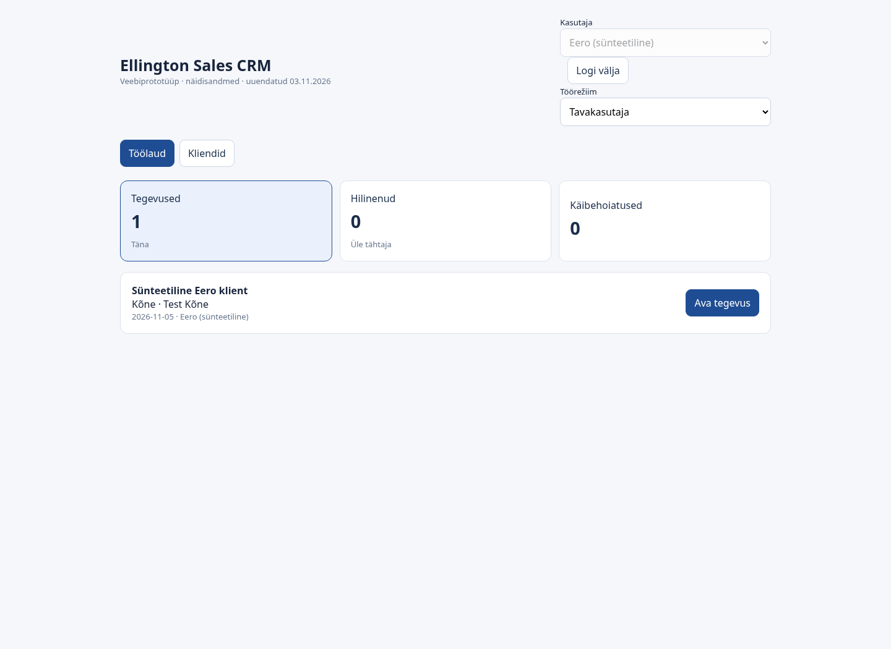
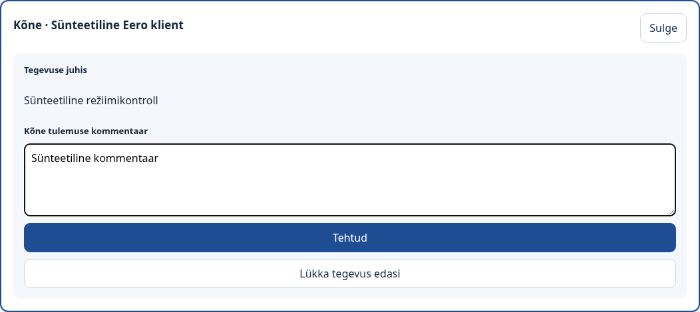
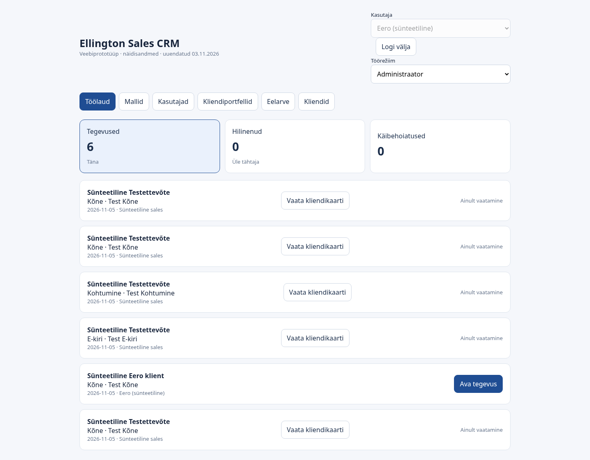
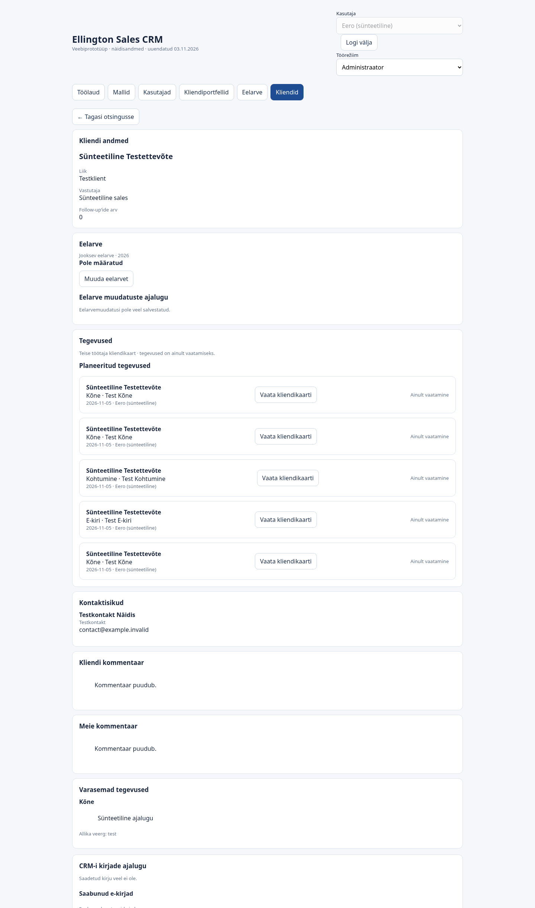
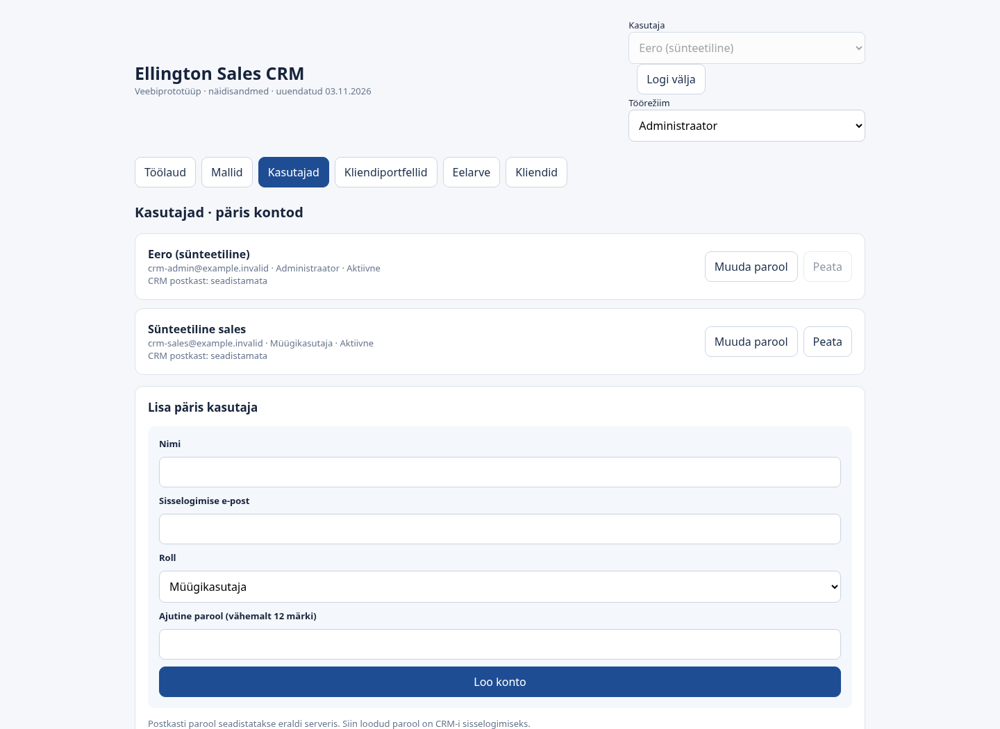

# Ellington CRM v8: töörežiimide aruanne

05.11.2026. Alustatud värskelt `main` harult, commit
`9287d5c` (ühendatud PR #1). Arendusharu: `feat/session-work-modes`.

## Käitumine

Paremas ülanurgas on administraatori kontol valik **Töörežiim**:
**Tavakasutaja** ja **Administraator**. Iga uus sisselogimine alustab
tavakasutaja režiimis. Valiku muutmine salvestab režiimi serveri sessiooni ning
laadib vaate uuesti, ilma uut sisselogimist nõudmata. Avatud salvestamata töövormi
korral küsitakse enne sulgemist kinnitust.

| Õigus | Tavakasutaja režiim | Administraatori režiim |
| --- | --- | --- |
| Kliendiotsing ja kliendikaart | Oma kliendid | Kõigi kliendid |
| Tegevuste nimekirjad | Oma tegevused | Kõigi tegevused |
| Oma tegevuse täitmine | Lubatud | Lubatud |
| Teise töötaja tegevuse lõpetamine, edasilükkamine või järgmise sammu muutmine | Keelatud | Keelatud |
| Teise töötaja kliendi tegevuse loomine või jälgimise lõpetamine | Keelatud | Keelatud |
| Kasutajate ja mallide haldus, lõpetamise põhjuste seadistus | Keelatud | Lubatud |
| Portfellide haldus ja olemasolevad administraatori koondvaated | Keelatud | Lubatud |

Tavaline müügitöötaja ei näe režiimivalikut ning server keeldub tema režiimi
administraatoriks muutmast. Brauseris valiku või API-päringu võltsimine ei anna
õigusi. Teiste tegevuste juures kuvatakse „Ainult vaatamine” ning kliendikaardi
vaatamise nupp. Teiste kliendikaardil ei kuvata tegevuste täitmise, loomise ega
jälgimise lõpetamise juhtnuppe.

## Rakendus

Konto püsiv `users.role` näitab administraatori võimekust; sessiooni `workMode`
määrab aktiivse režiimi. `server/work-mode.js` arvutab iga päringu jaoks aktiivsed
õigused andmebaasist loetud kontorolli ja sessiooni põhjal. `/api/me` ja
sisselogimise vastus tagastavad `accountRole`, `mode` ning aktiivse `role` väärtuse.
`POST /api/work-mode` aktsepteerib ainult `user` või `admin` väärtust, kontrollib
aktiivset kontot ja salvestab sessiooni enne vastamist.

Kõik CRM-i alamruuterid saavad sama aktiivsete õigustega kasutajaobjekti. Nii
kehtivad senised halduse ja andmete lugemise kontrollid ka režiimile. Lisatud on
omanikufilter kliendiotsingusse, kliendikaardile ja selle tegevuste nimekirja.
Tegevuste muutmise ühine töövooteenus kontrollib alati kliendi ning tegevuse
omaniku ID-d ka administraatori režiimis. Jälgimise lõpetamine keeldub peatamast
teise omanikuga aktiivset tegevust ka enda kliendil.

Režiimivahetus muudab ainult sessiooni: sama konto, parool ja kasutaja ID jäävad
alles. Andmebaasimigratsiooni pole vaja. Režiimivahetus ei tee portfelli üleandmist,
ei kirjuta tegevuste ajalugu ega muuda kliendi järeltegevuste loendurit.
Konto peatamine või administraatori rolli eemaldamine jõustub järgmise serveripäringu
õigusekontrollis. Ilma režiimiväljata varasem sessioon saab tavakasutaja õigused.

## Automaattestid

Käsk: `DB_NAME=ellington_test DB_PORT=3307 npm test`.
Kasutatud on kohalikku eraldatud MariaDB testandmebaasi ja sünteetilisi andmeid.
**14 testi läbitud, 0 ebaõnnestunud**, sh senised kuus integratsioonitesti ja
kaheksa uut režiimitesti.

Uued testid kontrollivad:

- Administraatori vaikimisi tavakasutaja režiimi, sama konto ID-d ja oma andmete nähtavust mõlemas tegevuste API-s ning kliendiotsingus.
- Režiimivahetuse püsimist järgnevas päringus ja halduse avamist administraatori režiimis.
- Muutmata kasutajakirjeid, kliendiomanikke, tegevusi, ajalugu ja loendureid: andmebaasikirjete võrdlus enne ning pärast mõlemasuunalist režiimivahetust.
- Teiste töötajate tegevuste lõpetamise, edasilükkamise, järgmise sammu, loomise ja jälgimise lõpetamise keelde mõlemas režiimis, ka otse API kaudu.
- Oma tegevuste lõpetamist mõlemas režiimis ning algse kasutaja ID salvestumist ajalukku.
- Müügitöötaja õiguste tõstmise keeldu, anonüümse ja vigase päringu keeldumist ning kontorolli muutumise arvestamist.
- Kasutaja, malli ja lõpetamispõhjuse haldustoimingute lubamist ainult administraatori režiimis.
- Erineva omanikuga tegevuse lõpetamise ja peatamise keeldu enda kliendil ning selle tegevuse nähtavust ainult administraatori režiimis.
- Vaikimisi tavakasutaja režiimi taastumist uuel sisselogimisel.

`git diff --check` ja brauserilehe JavaScripti süntaksikontroll: korras.

## Chromiumi kontroll

Chromium, töölauavaade 1440 × 1050. Sünteetilisele administraatori kontole anti
kontrolli ajaks kuvatav nimi „Eero (sünteetiline)”; päris Eero kontot ei kasutatud.
Sisselogimine toimus kasutajaliidese kaudu. Brauserikontroll kinnitas vaikimisi
režiimi, oma tegevuse vormi avamist ja kommentaari sisestamist, režiimi vahetamist
administraatoriks, teiste ülesannete ainult vaatamist, teise töötaja kliendikaarti,
kasutajahaldust ning vahetamist tagasi tavakasutajaks ja lehe uuestilaadimist.
Brauseri JavaScripti vigu ei registreeritud. Ekraanipiltidel väljade ja nuppude
kattumisi ei tuvastatud.

### Tavakasutaja režiim: enda ülesanded

### Enda tegevuse täitmise vorm

### Administraatori režiim: kõik ülesanded, teiste omad ainult vaatamiseks

### Teise töötaja kliendikaart

### Kasutajate haldus administraatori režiimis

## Ulatus ja piirangud

Kasutatud on ainult kohalikke `ellington_dev` ja `ellington_test` andmebaase ning
sünteetilisi `example.invalid` kontosid ja kontakte. SMTP/IMAP seadistused eemaldati
kontrolliprotsessist ning välised brauseripäringud ja saatmis-/sünkroniseerimise
päringud blokeeriti. Zone.ee tootmisserveri ega pärisandmebaasiga ei ühendutud ja
e-kirju ei saadetud. Mobiilivaadet selles ülesandes ei kontrollitud.
